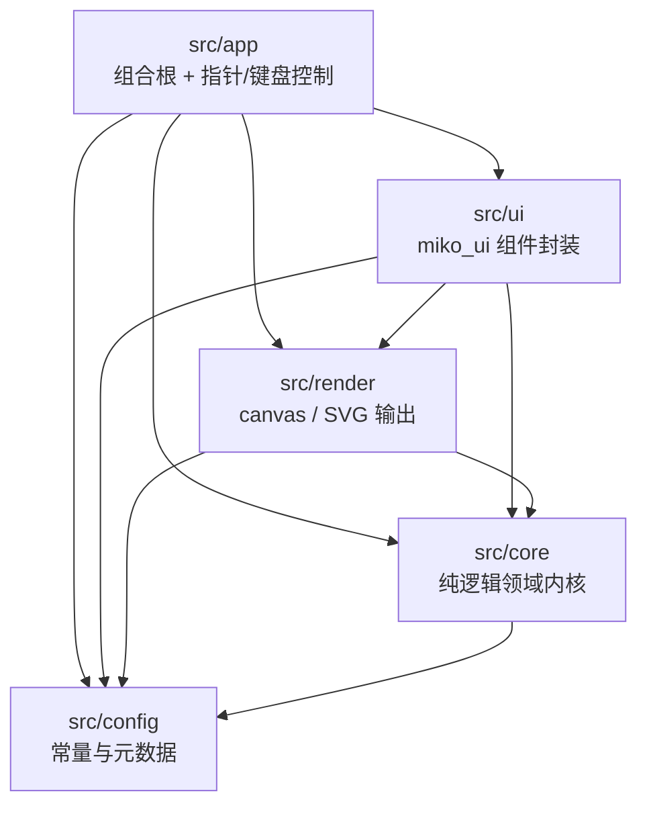
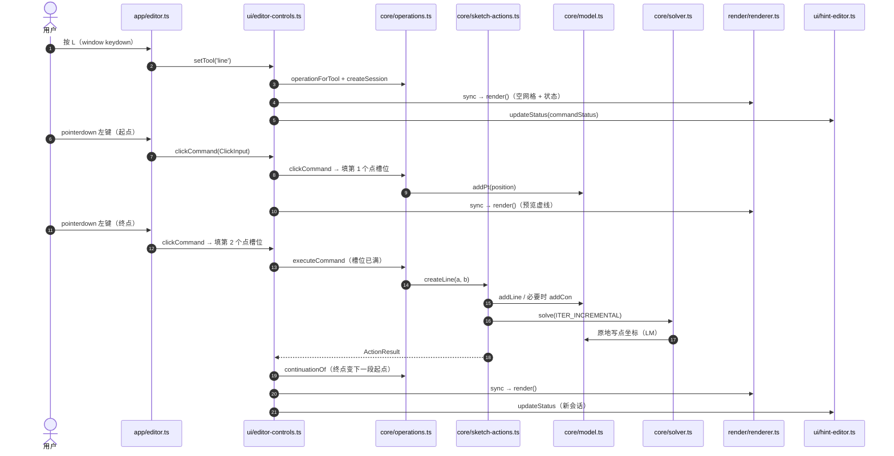

# 架构与调用链路（手把手）

> 面向第一次读这个仓库的人。目标：读完知道**这个项目由哪几层组成、一次点击在代码里怎么走完、要改某个东西该动哪些文件**。
> 使用方式、快捷键与质量门命令见 [README](../README.md)；本文只给地图和链路，不重复 README 的操作说明。

- 写作基线：`src/{app,core,render,ui,config}` 分层重构完成、`renderer.ts` 拆成「1 个编排类 + 5 个 draw-* 模块」之后。
- 文中所有函数名、文件名都从当前源码核对过；出现「写作时」的句子表示这是会随重构变化的事实。
- 代码里 `eslint.config.js` 的分层规则消息会直接指向本文的「依赖规则」一节——改分层时请回来同步。

## 0. 三十秒版本

这是一块**约束求解驱动的 SVG 草图板 demo**：canvas 2D 画草图，miko_ui 搭界面，数据放在一个全局 `model` 单例里，几何由 LM（Levenberg–Marquardt）求解器迭代满足约束。

架构只有五层，依赖只能向下：



“只能向下”指上图的实线方向；反向依赖先被 ESLint 的 `no-restricted-imports` 挡住，运行期反向依赖与循环依赖再由 `npm run arch`（`scripts/check_architecture.mjs`）兜底（详见 §8）。`core`/`render`/`ui` 还额外禁止依赖 miko_ui（`ui` 除外）。`config` 是叶子层，只允许被依赖；唯一例外是 `config/constraints-meta.ts` 用 `import type` 引用 `core` 的类型，运行期仍只有 `core → config`。

想最快建立直觉，按这个顺序读：`src/app/main.ts`（37 行装配）→ `src/app/editor.ts`（事件路由）→ `src/core/operations.ts` 文件头（命令模型）→ `src/core/model.ts`（数据）→ 本文 §4/§5 两条链路。

## 1. 目录地图

> README 的 [「目录结构」](../README.md#目录结构) 是速查版（每个目录/文件一行），本文 §1 是详细版；两者冲突时以源码与本文为准，并回来同步。
> 分层与质量门另见 [「依赖方向与配置分层」](../README.md#依赖方向与配置分层)、[「运行与质量门」](../README.md#运行与质量门)、[「ESLint 规则要点」](../README.md#eslint-规则要点)。

### 1.1 根目录

| 路径                                  | 一句话职责                                                                        |
| ------------------------------------- | --------------------------------------------------------------------------------- |
| `index.html`                          | 唯一挂载点 `#app` + `src/app/main.ts` 模块脚本；页面骨架全由 JS 建                |
| `package.json`                        | 脚本（dev/build/typecheck/lint/arch/format/test/check）与唯一运行期依赖 `miko_ui` |
| `src/styles.css`                      | 页面网格、`.app-*` 消费者类、canvas 绘制 token（`:root` 是主题单一来源）          |
| `eslint.config.js`                    | 分层 import 禁令 + 通用规则（见 §8）                                              |
| `tsconfig.json`                       | strict + `noUncheckedIndexedAccess` + `verbatimModuleSyntax` 等编译口径           |
| `vite.config.ts` / `vitest.config.ts` | Vite 构建（本地库白名单 / studio 代理 + 自动拉起）/ node 环境单测（`tests/**/*.test.ts`） |
| `scripts/dev_ui_link.mjs`             | 本地 miko_ui 工作副本 ↔ npm 版的 link/unlink/status/auto 切换                     |
| `scripts/check_architecture.mjs`      | `npm run arch`：src 运行期依赖只能向下 + 无环检查（见 §8.3）                      |

### 1.2 `src/app/`：装配与事件控制

| 文件        | 一句话职责                                                                                                  |
| ----------- | ----------------------------------------------------------------------------------------------------------- |
| `main.ts`   | 组合根：引样式 → `mountAppShell` → 读主题/文本测量 → `new Editor` → 通知区 → `buildToolbar` → `bindToolbar` |
| `editor.ts` | 指针/键盘事件接线 + 手势状态机（拖拽/平移/尺寸/框选）；把点击交给 `EditorControls`，自己不写领域逻辑        |

### 1.3 `src/core/`：纯逻辑领域层（可在 node 里直接测）

| 文件                | 一句话职责                                                                                     |
| ------------------- | ---------------------------------------------------------------------------------------------- |
| `types.ts`          | 非图元的数据类型：`Point`、`Constraint`、`Selection`、`Snap`、`Marquee`、`MeasureText` 等      |
| `vec.ts`            | 二维向量纯函数（`safeLen` 零长度返回 1，供残差归一化）                                         |
| `camera.ts`         | 世界 ↔ 屏幕换算、缩放钳制、网格间距；全局 `cam` 快照 `CameraView`                              |
| `viewport.ts`       | 视图交互写入口：`fitView` / `wheelZoom` / `beginPan` / `applyPan`                              |
| `state.ts`          | 交互状态单例 `state` + 有序选择集操作（`setSelection` / `deselect` / `toggleSelected` 等）     |
| `model.ts`          | 点/图元/约束容器单例 `model`（`pts`/`ents`/`cons`/`seq`）与增删查、级联清理、注入门面          |
| `entities.ts`       | 图元多态类 `EntityBase` 子类（直线/圆/圆弧/点图元）→ 几何归一为 `EntityPrimitive`              |
| `geometry.ts`       | 拾取、吸附、包围盒、框选判定；只对 `segment`/`circular`/`dot` 三种基元写一次数学               |
| `constraints.ts`    | 引用校验 `isConstraintRefsValid` + 残差表 `RESID`（`Record<ConstraintKind, …>` 强制穷尽）      |
| `solver.ts`         | `solveSketch`：LM + 数值雅可比，原地写回点坐标/圆半径，报告 `invalidConstraints`               |
| `dimensions.ts`     | 尺寸单一元数据表 `DIM_META`：取值/设值/文案/校验/布局/命中/拖拽/图元匹配                       |
| `selection.ts`      | 选择语义：单击/Shift/框选方向、拖拽点集、已选列表数据、命令悬停候选                            |
| `sketch-actions.ts` | 原子领域动作与统一求解入口 `solve`：画图/加约束/删除/固定/构造/尺寸/拖拽                       |
| `operations.ts`     | 统一操作引擎：`Operand`/`SlotSpec`/`OperationMeta`、命令会话、槽位填充、命令文案/预览、`TOOLS` |

### 1.4 `src/render/`：绘图与输出层

| 文件                 | 一句话职责                                                                                           |
| -------------------- | ---------------------------------------------------------------------------------------------------- |
| `renderer.ts`        | **只做编排**：canvas/DPR `resize()`、`render()` 按「网格 → 图元/点 → 尺寸 → 覆盖物」调用下面五个模块 |
| `draw-primitives.ts` | 绘制原语：屏幕线段 `lineScreen`、实心箭头 `arrowScreen`、世界几何基元描边 `strokePrimitive`          |
| `draw-grid.ts`       | 网格 + 原点十字 `drawGrid`                                                                           |
| `draw-entities.ts`   | 图元/点绘制 `drawEntity` / `drawPoint` / `isSelectedForRender`                                       |
| `draw-dimensions.ts` | 尺寸布局原语绘制 `drawDim` / `drawDimLayout` / `drawDimText`                                         |
| `draw-overlays.ts`   | 交互覆盖物：命令预览 `drawPreview`、框选 `drawMarquee`、吸附标记 `drawSnapMarker`                    |
| `theme.ts`           | `readTheme()`：从 `src/styles.css :root` 读一次主题 token（缺失回退默认值）                          |
| `export-svg.ts`      | 纯函数 `buildSVG()`：按几何基元生成 SVG；约束/尺寸不导出                                             |

> 拆分已完成（写作时 `renderer.ts` 约 70 行）：只留 `Renderer` 类——`resize()` 管 canvas/DPR 尺寸、`render()` 做编排、构造签名不变；所有 `draw-*` helper 都显式接收 `ctx`/`theme`/数据，不读全局，运行期 import 无环（`npm run arch` 验证）。如果你读到时 `renderer.ts` 又变厚，说明拆分回退了，但职责划分仍按上表理解。

### 1.5 `src/ui/`：miko_ui 组件封装

| 文件                 | 一句话职责                                                                           |
| -------------------- | ------------------------------------------------------------------------------------ |
| `app-shell.ts`       | `mountAppShell`：在 `#app` 网格里建侧栏/dock/画布/通知区宿主，并接侧栏拖拽条         |
| `toolbar.ts`         | `buildToolbar`：顶部 dock（工具分段、约束按钮、固定/构造、吸附开关、适应/导出/清空） |
| `editor-controls.ts` | 工具栏命令实现 + 唯一同步入口 `sync()`（重绘 + 已选列表 + 状态栏）                   |
| `status-panel.ts`    | 左侧通高状态栏外壳：标题 + 「已选择」插槽 + 状态/输入插槽                            |
| `selection-list.ts`  | 「已选择」列表：行、种类徽章、行内约束胶囊「×」、内容签名去重                        |
| `hint-editor.ts`     | 状态区两行 `<output>` + 尺寸数字输入框（提交/取消/非法态/闪示 info）                 |
| `parse-dim-input.ts` | 尺寸输入的纯解析（node 可测，无 DOM）                                                |
| `notify.ts`          | error 进 miko_ui 消息区、info 交给状态栏闪示；自绘确认框 `askConfirm`                |
| `download.ts`        | Blob/`<a download>`/objectURL 下载适配器                                             |
| `measure-text.ts`    | `createTextMeasurer()`：canvas `measureText` 适配器（无 canvas 时回退估算）          |
| `sidebar-resizer.ts` | 侧栏宽度拖拽/键盘调整、clamp、读屏值、localStorage 记忆                              |

### 1.6 `src/config/`：常量与元数据

| 文件                  | 一句话职责                                                                           |
| --------------------- | ------------------------------------------------------------------------------------ |
| `index.ts`            | 汇总出口；业务代码统一 `from '../config'`，不深引内部文件                            |
| `angle.ts`            | `TAU` / `sweepOf` / `normalizeAngle` / `isFullSweep` / 折线段数                      |
| `constraints-meta.ts` | 16 种约束的 `CONSTRAINT_META`（label / refs / unorderedRefs）+ 去重键 + 引用字段推导 |
| `export.ts`           | 导出标定：颜色/线宽/精度/文件名/虚线/点半径/空图文案                                 |
| `format.ts`           | `formatNumber` / `formatDimValue`（显示格式；回填用全精度 `String(value)`）          |
| `layout.ts`           | 侧栏宽度记忆键与键盘步长；CSS 读不到时的兜底值                                       |
| `limits.ts`           | 视图/模型上限：缩放范围、网格、退化阈值、id 初值                                     |
| `solver.ts`           | LM 迭代预算 `ITER_*`、收敛阈值、λ 超参、雅可比步长                                   |
| `tolerances.ts`       | 拾取/吸附/尺寸命中/拖拽阈值（屏幕像素）+ `worldTol` + 吸附优先级                     |
| `ui.ts`               | 无法用 CSS 表达的交互常量（滚轮灵敏度、尺寸文字留白、角度弧最小半径等）              |

### 1.7 `tests/`

| 目录/文件                          | 一句话职责                                                                                                                                                                       |
| ---------------------------------- | -------------------------------------------------------------------------------------------------------------------------------------------------------------------------------- |
| `tests/core/*.test.ts`             | core 与 config 的纯逻辑：vec/angle/format、model、entities、geometry、constraints、solver、dimensions、selection、sketch-actions、operations、point-entity、coincident/collinear |
| `tests/core/fixtures.ts`           | 夹具：`addArcByAngles` 把「圆心+半径+起终角」换成三个点                                                                                                                          |
| `tests/render/export-svg.test.ts`  | `buildSVG` 的纯输出（整圆 `<circle>`、弧 `<path>`、构造虚线、无 NaN）                                                                                                            |
| `tests/ui/parse-dim-input.test.ts` | 尺寸输入纯解析                                                                                                                                                                   |

## 2. 从 `index.html` 到第一帧：装配顺序

`src/app/main.ts` 只有 37 行，但顺序是契约。按真实执行顺序：

1. **`index.html`** 加载 `src/app/main.ts`（`<script type="module">`），页面里只有 `#app`。
2. **样式加载顺序（契约）**：`import 'miko_ui/styles.css'` 先、`import '../styles.css'` 后——后者可以覆盖库的 token，也给 `.app-*` 写布局。
3. **取挂载点**：`document.getElementById('app')`，缺了直接抛错。
4. **`mountAppShell(app)`**（`src/ui/app-shell.ts`）一次建好五个节点并返回句柄：
   - `sidebarRoot`（`.app-status` 左侧通高栏）、`separator`（`.app-sidebar-resizer`，`role="separator"`）；
   - `dockRoot`（`.dock.app-dock`，`role="toolbar"`）、`canvas`（`#canvas.app-canvas`）、`noticesRoot`（`.app-notices`）；
   - 末尾 `bindSidebarResizer(app, separator)`：读 `localStorage` 宽度、clamp、写 `--status-sidebar-width`。
5. **`readTheme()`**（`src/render/theme.ts`）只在启动时读一次 `getComputedStyle(document.documentElement)`，把画布颜色/线宽/虚线/字体读成 `Theme`（缺失回退同值默认值并告警）。
6. **`createTextMeasurer()`**（`src/ui/measure-text.ts`）注入一个 `MeasureText`，让尺寸布局不需要 DOM。
7. **`new Editor(shell.canvas, shell.sidebarRoot, theme, measureText)`**（`src/app/editor.ts`）内部顺序：
   1. `new Renderer(canvas, theme)`（`src/render/renderer.ts`）；
   2. `new StatusPanel(sidebarRoot)` → 左侧「草图状态」面板 + `selectionSlot`/`statusSlot` 两个插槽；
   3. `new HintEditor(statusPanel.statusSlot, { onCommit, onCancel })` → 状态两行 + 尺寸输入框；
   4. `new EditorControls({ canvas, hintEditor, renderer, selectionSlot, getToolbar })`（`src/ui/editor-controls.ts`）；
   5. `createToolbarHandlers(this.controls)` → 生成 `editor.handlers`（工具栏回调适配器）；
   6. `attachEvents()` 挂 canvas 的 `pointerdown/move/up/cancel`、`contextmenu`、`wheel` 与 window 的 `keydown`；
   7. `new ResizeObserver(() => renderer.resize()).observe(canvas)`，再主动 `renderer.resize()` 一次：写 `cam.viewportW/H`、按 DPR 设 canvas 像素尺寸、`render()` 出第一帧（空网格）。
8. **`initNotifications(noticesRoot, (message) => editor.flashInfo(message))`**（`src/ui/notify.ts`）建消息区并 flush 此前排队的提示——所以「先构造 Editor、后接通知」不会丢提示。
9. **`buildToolbar(dockRoot, editor.handlers)`**（`src/ui/toolbar.ts`）：
   - 工具分段 `createSegmented`（`TOOLS` 顺序，默认 `select`）→ 点击 `handlers.setTool(id)`；
   - 约束按钮（`CONSTRAINT_OPERATIONS`）→ 点击 `handlers.armOperation(op.id)`；
   - 视图与文件区：吸附开关 `createSwitch`（`toggleSnap`）、固定/构造（`EDIT_OPERATIONS`）、适应/导出/清空；
   - 返回 `ToolbarHandle`：`setActiveTool` / `setActiveOperation` / `setSnap`。
10. **`editor.bindToolbar(toolbar)`**：`toolbar.setSnap(state.snapEnabled)`，然后 `controls.setTool('select')` → `cancelCommand()` → `showTool('select', null)` → `sync()`，第一帧状态栏显示「选择（V）」及其提示。

**为什么这个顺序**：主题/文本测量要在 `Editor` 构造前就准备好（构造参数注入）；工具栏要等 `EditorControls` 存在（回调来自 `editor.handlers`），所以 `bindToolbar` 必须最后；`ResizeObserver` 收所有布局变化（窗口缩放、侧栏拖拽、dock 换行），比只监听 `window.resize` 完整。

## 3. 统一命令模型（读两条链路前必须知道）

所有需要参数的操作（绘图、约束、删除、固定、构造、尺寸）都走 `src/core/operations.ts` 的同一条管线：

- **操作** = 元数据 `OperationMeta`：`id` / `label` / `group`（`draw`/`constraint`/`edit`）/ `tool` / `slots(values)` / `execute(values, ctx)` / 可选 `continueWith(values)`。
- **参数槽位** `SlotSpec`：`accepts` 声明接受哪种 `Operand`；`place: 'point' | 'position'` 允许空白点击落参（新建/复用点，或只取位置）；`optional`（尺寸的第二条直线，留空算齐）；`repeat`（删除/固定/构造/水平/竖直：每填一个就执行一次，命令保持可继续点）；`reject` 在写模型前做上下文排除。
- **操作数** `Operand`：`point`（模型里的点）/ `position`（只有世界坐标）/ `entity`（图元）/ `dim`（已有尺寸）。
- **命令会话** `CommandSession`：`{ opId, values: (Operand | undefined)[], owned: Set<number> }`，存在 `state.command`。`owned` 记录「本次会话点击新建、还没并入图元」的点，回退/取消时删除，避免孤立点。
- **执行时机**：槽位填满立即执行（正常不需要 Enter）；`Enter` 只是兜底，`Backspace` 回退最后一参，`Esc` 放弃。
- **选择集预填**：启动操作时 `EditorControls.armOperation` 先 `operandsFromSelection(state.selection)` + `fillFromOperands`，装不满就在收集态等画布点击。

`TOOLS`（工具顺序/快捷键/提示）也从 `operations.ts` 导出；工具栏的按钮表和状态栏文案都以操作表为单一来源。

## 4. 手把手链路 A：画一条直线

前提：§2 的装配已完成（工具栏已 `bindToolbar`、第一帧已渲染）。下面从用户按 `L` 开始，一直走到状态栏同步。

涉及文件：`src/app/editor.ts` → `src/ui/editor-controls.ts` → `src/core/operations.ts` → `src/core/sketch-actions.ts` → `src/core/model.ts` → `src/core/solver.ts` → `src/render/renderer.ts` → `src/ui/hint-editor.ts`。



### 4.1 启动直线操作（键盘）

| #   | 触发       | 文件 → 函数                                                                                                                              | 数据变化                                                                                                   | 界面表现                                                                                                             |
| --- | ---------- | ---------------------------------------------------------------------------------------------------------------------------------------- | ---------------------------------------------------------------------------------------------------------- | -------------------------------------------------------------------------------------------------------------------- |
| 1   | 用户按 `L` | `src/app/editor.ts` → `Editor.onKeyDown`                                                                                                 | 无                                                                                                         | 无                                                                                                                   |
| 2   |            | `TOOLS.find(t => t.key === 'l')` 命中直线工具 → `EditorControls.setTool('line')`                                                         | `src/core/operations.ts` 的 `TOOLS` 提供 `{id:'line', key:'l'}`                                            |                                                                                                                      |
| 3   |            | `src/ui/editor-controls.ts` → `setTool` → `armOperation(operationForTool('line').id)`                                                    | 无                                                                                                         |                                                                                                                      |
| 4   |            | `armOperation('line')` → `startSession('line')` → `createSession('line')`                                                                | `state.command = { opId:'line', values:[], owned:new Set() }`；`state.snap = null`；`state.marquee = null` |                                                                                                                      |
| 5   |            | `showTool('line', null)`                                                                                                                 | `state.tool='line'`；`toolbar.setActiveTool('line')`；工具栏「直线」高亮；canvas 加 `is-drawing` 类        | 光标/高亮切换                                                                                                        |
| 6   |            | `operandsFromSelection(state.selection)` 为空 → `fillFromOperands` 未填 → `isComplete` false                                             | 会话保持空                                                                                                 |                                                                                                                      |
| 7   |            | `sync()` → `renderer.render()`；`selectionList.update([])`；`currentStatus()` → `commandStatus(session)`；`hintEditor.updateStatus(...)` | 无                                                                                                         | 状态栏第一行「命令 直线 ▸ 起点：待选（点一个起点） ▸ 终点：待选（点一个终点）」，第二行「点击画布补参数 · Esc 取消」 |

注意：`Editor.onKeyDown` 在 `hintEditor.editing` 时直接返回，所以尺寸输入框聚焦时单键快捷键不会误触。

### 4.2 第一次点击：填起点槽位

| #   | 触发                  | 文件 → 函数                                                                                                                                                    | 数据变化                                                                                                                         | 界面表现                                                                                         |
| --- | --------------------- | -------------------------------------------------------------------------------------------------------------------------------------------------------------- | -------------------------------------------------------------------------------------------------------------------------------- | ------------------------------------------------------------------------------------------------ |
| 8   | `pointermove`（可选） | `Editor.onPointerMove` → `pointerS` → `state.cursorWorld = s2w(sp)`；`updateHover(...)` → `computeSnap` / `commandHover`                                       | `state.snap`（吸附候选）、`state.hoverPt/hoverEnt/hoverDim`                                                                      | 吸附十字、预览跟随光标                                                                           |
| 9   | `pointerdown` 左键    | `Editor.onPointerDown`：`setPointerCapture`；`pointerS`；`ev.button === 0` → `onPrimaryClick(sp, shiftKey)`                                                    | `state.cursorWorld`                                                                                                              |                                                                                                  |
| 10  |                       | `onPrimaryClick`：`state.command` 存在 → `EditorControls.clickCommand(clickInput())`                                                                           | `clickInput()` = `{ w: state.cursorWorld, zoom: cam.z, view: cam, snap: state.snap, measureText, font: theme.dimFont }`          |                                                                                                  |
| 11  |                       | `EditorControls.clickCommand` → `operations.clickCommand(session, input)`                                                                                      |                                                                                                                                  |                                                                                                  |
| 12  |                       | `clickCommand`：`isComplete` false → `clickCandidates(input)` 依次试 `pickDim` / 吸附点 / `pickPoint` / `pickPointEntity` / `pickEntity`，得到候选操作数与落点 | 无（只读模型）                                                                                                                   |                                                                                                  |
| 13  |                       | 第 0 个槽位 `place === 'point'` → `fillPointSlot`：候选里没有可复用点 → `addPt(position.x, position.y)`；`session.owned.add(id)`；`tryFill` 写入 `values[0]`   | **`model.pts` 新增一个 `Point {id, x, y, fixed:false}`（`model.seq++`）**；`state.command.values[0] = {kind:'point', point, at}` |                                                                                                  |
| 14  |                       | 回到 `EditorControls.clickCommand`：`filled === true`，但 `isComplete` 仍 false（终点槽位空）→ `sync()`                                                        |                                                                                                                                  | 画布出现起点小点 + 起点到光标的虚线预览；状态栏变为「命令 直线 ▸ 起点：点 #N ▸ 终点：待选（…）」 |

这里就是**槽位模型的价值**：点击没有「按工具分叉」的 pending 状态机，只是往当前空槽位里填一个能填的操作数；填不进会返回原因，不会先写模型再报错。

### 4.3 第二次点击：槽位填满 → 立即执行

| #   | 触发                       | 文件 → 函数                                                                                                                                                                                                                                       | 数据变化                                                                          | 界面表现                                                                                    |
| --- | -------------------------- | ------------------------------------------------------------------------------------------------------------------------------------------------------------------------------------------------------------------------------------------------- | --------------------------------------------------------------------------------- | ------------------------------------------------------------------------------------------- |
| 15  | `pointerdown` 左键（终点） | 同 9–11 → `operations.clickCommand`                                                                                                                                                                                                               |                                                                                   |                                                                                             |
| 16  |                            | 第 1 个点槽位 → `fillPointSlot` → `addPt` / 或复用吸附点；`values[1]` 写入                                                                                                                                                                        | **`model.pts` 再增一个点**（或共享已有点）；`session.owned` 再记一个 id           |                                                                                             |
| 17  |                            | 回到 `EditorControls.clickCommand`：`result.filled && isComplete(session)` → `runCommand(input.zoom, 'click')`                                                                                                                                    |                                                                                   |                                                                                             |
| 18  |                            | `runCommand` → `operations.executeCommand(session, zoom)`：`isComplete` 通过 → `operationById('line').execute(filledValues, ctx)`                                                                                                                 | `ctx = { zoom, owned: session.owned }`                                            |                                                                                             |
| 19  |                            | `lineOperation.execute` → `pointOf(values[0])`、`pointOf(values[1])` → `sketch-actions.createLine(a, b)`                                                                                                                                          | 无                                                                                |                                                                                             |
| 20  |                            | `createLine`：距离 < `MIN_DRAW_LENGTH` 则失败；否则 `addLine(a, b)`（`model.ts` 导出）                                                                                                                                                            | **`model.ents` 新增 `LineEntity {id, a, b, construction:false}`**                 |                                                                                             |
| 21  |                            | `createLine` 的 `autoConstrain` 分支：`Math.abs(dy) < Math.abs(dx) * AUTO_AXIS_RATIO`（0.02）→ `addCon('horizontal', { e: line.id })`；竖直分支对称                                                                                               | **`model.cons` 可能新增一条水平/竖直约束**（近轴才加）                            |                                                                                             |
| 22  |                            | `solve(ITER_INCREMENTAL)` → `sketch-actions.solve` → `solver.solveSketch(40)`                                                                                                                                                                     | LM 原地移动未固定点的 `x/y`（例如近水平线的 y 被拉平到相等）                      |                                                                                             |
| 23  |                            | `solveSketch` 返回 `{residual, converged, invalidConstraints}`；`solve()` 把 `residual > SOLVE_WARN_EPS` 翻成 error 提示、无效约束翻成「有 N 条约束引用了不存在的对象」                                                                           | 无                                                                                |                                                                                             |
| 24  |                            | `createLine` 返回 `actionOk(notices)` → `OperationOutcome {kind:'action'}`                                                                                                                                                                        |                                                                                   |                                                                                             |
| 25  |                            | `EditorControls.runCommand`：成功且非尺寸 → `afterSuccessfulTool('line', true)`                                                                                                                                                                   |                                                                                   |                                                                                             |
| 26  |                            | `afterSuccessfulTool`：非 repeat、`op.tool === 'line'` → `continuationOf(state.command)` → `lineOperation.continueWith(values)` 返回 `[pointOperand(b)]` → `state.command = {opId:'line', values:[b], owned:new Set()}`，`showTool('line', null)` | 旧会话被替换；**终点 b 已成为下一段的起点**（点已并入直线，所以不再计入 `owned`） | 工具栏「直线」保持高亮，命令继续                                                            |
| 27  |                            | `apply(outcome.result)` → `notifyAll(notices)` → `sync()`                                                                                                                                                                                         |                                                                                   |                                                                                             |
| 28  |                            | `sync()`：`renderer.render()` 按序画网格 → 图元（`drawEntity` → `primitiveOf` 得 `segment` → `strokePrimitive`）→ 点（`drawPoint`）→ 尺寸 → 预览 → 框选/吸附；`selectionList.update`；`currentStatus`；`hintEditor.updateStatus`                  | 无                                                                                | 画布出现实线；状态栏「命令 直线 ▸ 起点：点 #N ▸ 终点：待选」；曲线/约束若加重了会自动补提示 |

**连续画**：第 3 次点击会以刚画的终点为起点，只填终点槽位就执行，所以能一段接一段。`Esc`/右键单击结束：

- `Editor.onKeyDown` 的 `Escape` → `cancelAction` → `state.command` 存在 → `controls.cancelCommand()`；
- `cancelCommand` → `endCommand` → `operations.cancelCommand(session)` 删除 `session.owned` 里还没并入图元的点；`state.command = null`；`snap/marquee` 清空；`showTool('select', null)`；`sync()`。
- 右键**单击**（`pointerdown` + `pointerup` 未拖动）在 `finishGesture` 里也走同一个 `cancelAction`。

## 5. 手把手链路 B：给一条直线加水平约束

有两种入口，底层是同一条链路：

- **入口 1（推荐先读）**：选择工具选中直线 → 点工具栏「水平」按钮（`armOperation` 用选择集预填槽位，填满立即执行）。
- **入口 2**：先点「水平」按钮进入收集态 → 在画布上点直线（`clickCommand` 补槽位，填满立即执行）。

### 5.1 入口 1：先选中，再点「水平」

| #   | 触发               | 文件 → 函数                                                                                                                                                                       | 数据变化                                                                                                                                             | 界面表现                                                                                                                                              |
| --- | ------------------ | --------------------------------------------------------------------------------------------------------------------------------------------------------------------------------- | ---------------------------------------------------------------------------------------------------------------------------------------------------- | ----------------------------------------------------------------------------------------------------------------------------------------------------- |
| 1   | 选择工具下单击直线 | `editor.onPrimaryClick` → `state.command` 为空、`state.tool === 'select'` → `pickDim` 未命中 → `selection.clickSelect`                                                            | `selectOnly([{kind:'ent', id}])` 写入 `state.selection`；返回 `dragPoints = 直线两端点`                                                              | 直线与端点高亮；已选列表出现一行                                                                                                                      |
| 2   |                    | `Editor.startDrag(points)`：记录 `startW`、每个点的 `ox/oy`、`exclude` 集合；`clearHover()`                                                                                       | `Editor.gesture = {kind:'drag', ...}`（手势瞬态，不进模型）                                                                                          |                                                                                                                                                       |
| 3   | `pointerup`        | `Editor.finishGesture` → `controls.finishDrag(false)` → `solve(ITER_FULL)`（80 次迭代）+ `sync()`                                                                                 | 没拖动时点坐标不变（求解空跑）                                                                                                                       | 选中态保持                                                                                                                                            |
| 4   | 点击工具栏「水平」 | `buildToolbar` 里按钮 `onClick` → `editor.handlers.armOperation('horizontal')`                                                                                                    | 按钮表来自 `CONSTRAINT_OPERATIONS`（`horizontalOperation`）                                                                                          |                                                                                                                                                       |
| 5   |                    | `EditorControls.armOperation` → `startSession('horizontal')`                                                                                                                      | `state.command = createSession('horizontal')`；`snap/marquee` 清空；`showTool(op.tool ?? 'select' → 'select', 'horizontal')` → `state.tool='select'` | 工具栏切回「选择」，但「水平」按钮 `is-active` + `aria-pressed`；canvas 保持 `is-drawing`                                                             |
| 6   |                    | `operandsFromSelection(state.selection)` → `[entityOperand(line)]`；`fillFromOperands` → `fillOne` 找到槽位 0（`lineSlot('直线', …, repeat)`），`canFill` 通过 → 写入 `values[0]` | 会话 `values[0] = {kind:'entity', entity:line}`                                                                                                      |                                                                                                                                                       |
| 7   |                    | `isComplete(session)` 为 true（repeat 槽位已填）→ `runCommand(cam.z, 'arm')`                                                                                                      |                                                                                                                                                      |                                                                                                                                                       |
| 8   |                    | `runCommand` → `executeCommand` → `horizontalOperation.execute(values)`                                                                                                           | 组装 `[{ kind:'horizontal', props:{ e: line.id } }]`                                                                                                 |                                                                                                                                                       |
| 9   |                    | `sketch-actions.addConstraints(items)`：先 `findConstraint`（`model.ts` 导出，按 `constraintRefKey` 去重）；不存在 → `addCon('horizontal', { e })`                                | **`model.cons` 新增 `{id, type:'horizontal', e}`**                                                                                                   |                                                                                                                                                       |
| 10  |                    | `solve(ITER_CONSTRAINT)`（120 次迭代）→ `solveSketch`：`RESID.horizontal` = `a.y - b.y`，LM 移动未固定端点直到 y 相等                                                             | 直线两端点 y 坐标被写回相等（若端点 fixed，则残差留给提示）                                                                                          | 直线被「拉平」                                                                                                                                        |
| 11  |                    | `addConstraints` 返回 `actionOk(notices)`（有重复时带「已跳过 N 个重复约束」info）                                                                                                |                                                                                                                                                      |                                                                                                                                                       |
| 12  |                    | `afterSuccessfulTool('horizontal', true)`：`isRepeatOperation` 为 true → `startSession('horizontal')` 重开空会话                                                                  | `state.command = 新会话`；工具高亮保持                                                                                                               | 命令保持可继续点                                                                                                                                      |
| 13  |                    | `apply(result)` → `notifyAll` → `sync()`：重绘 + 已选列表 + 状态栏                                                                                                                | 无                                                                                                                                                   | 直线变水平；已选列表该行出现约束胶囊「水平」；状态栏「命令 水平 ▸ 直线：待选（点一条直线立即生效（可继续点））」，提示行「点击画布补参数 · Esc 取消」 |
| 14  | 继续点下一条直线   | `onPrimaryClick` → `state.command` → `controls.clickCommand` → `operations.clickCommand` 填 repeat 槽位 → `runCommand(..., 'click')` → 同上 8–13                                  | 每点一条加一条约束并求解                                                                                                                             | 按钮保持高亮                                                                                                                                          |
| 15  | `Esc` / 右键单击   | `cancelAction` → `controls.cancelCommand()` → `endCommand`（删除 owned 临时点）→ `showTool('select', null)` → `sync()`                                                            | `state.command = null`；选择集保持不变                                                                                                               | 「水平」按钮取消高亮，回到选择工具                                                                                                                    |

补充细节：

- **重复约束**：`addConstraints` 全部重复时返回 `actionFail('相同约束已存在')`；部分重复会「跳过 + info 提示」。
- **松弛变量**：若两条端点都 `fixed`，水平约束无法满足，`solve()` 会因 `residual > SOLVE_WARN_EPS`（1e-6）返回 error 提示「约束未完全满足」。
- **删除约束**：唯一入口是「已选择」行内约束胶囊的「×」→ `selection-list` 回调 `EditorControls.removeConstraint(id)` → `sketch-actions.deleteConstraint(id)` → `removeConstraint`（`model.ts` 导出）+ `solve(ITER_INCREMENTAL)`。没有单独的「删约束」工具。
- **为什么水平/竖直是 repeat**：`isRepeatOperation` 检查 `operationById(id).slots([])` 里是否有 `repeat`；水平/竖直的槽位是 `lineSlot(..., repeat=true)`，所以每点一条立即执行且命令保持。

### 5.2 入口 2：先点按钮，再点直线

| #   | 触发           | 文件 → 函数                                                                                         | 数据变化                                                                                                                                |
| --- | -------------- | --------------------------------------------------------------------------------------------------- | --------------------------------------------------------------------------------------------------------------------------------------- |
| 1   | 点「水平」按钮 | `handlers.armOperation('horizontal')` → `startSession`                                              | `state.command` 建立，选择集为空 → `fillFromOperands` 用掉 0 个 → `isComplete` false → `sync()`，状态栏提示「直线：待选」               |
| 2   | 指针悬停直线   | `Editor.onPointerMove` → `selection.updateHover` → `operations.commandHover`                        | 只高亮**真正能填进空槽位**的对象（直线），这是收集态反馈                                                                                |
| 3   | 单击直线       | `onPrimaryClick` → `controls.clickCommand` → `operations.clickCommand` → `tryFill` 写入 repeat 槽位 | `values[0] = entity`；回到 `EditorControls.clickCommand` 时 `isComplete` true → `runCommand(..., 'click')`；之后与 5.1 的第 8–15 步相同 |

## 6. 其它事件路由速查

`src/app/editor.ts` 是唯一的 DOM 事件入口，规则很短：

| 事件                          | 路由                                                                                                                                                                                        |
| ----------------------------- | ------------------------------------------------------------------------------------------------------------------------------------------------------------------------------------------- |
| `pointerdown` 左键            | `onPrimaryClick`：有命令 → `EditorControls.clickCommand`；否则选择工具：尺寸命中 → 尺寸手势，点/图元 → 选择/拖拽，空白 → 开始框选                                                           |
| `pointerdown` 中/右键         | `gesture = {kind:'pan'}` + `beginPan`；右键单击未拖动 = 取消当前操作                                                                                                                        |
| `pointermove`                 | 依次判断 pan → drag → dim → marquee，否则 `updateHover` + `sync()`                                                                                                                          |
| `pointerup` / `pointercancel` | `finishGesture`：拖拽结束 `controls.finishDrag(cancelled)`；尺寸未拖动 = 单击打开输入框；框选结算 `applyMarquee`                                                                            |
| `wheel`                       | `wheelZoom`（以指针为锚）+ `sync()`                                                                                                                                                         |
| `keydown`                     | 输入框编辑中让位；`Enter` 兜底执行；`Esc` 阶梯：输入框 → 框选 → 命令 → 工具回选择 → 清空选择；`Backspace` 有命令回退参数、无命令删除选中；`Delete` 删除；`S` 开关吸附；其余单键命中 `TOOLS` |
| 尺寸输入框                    | `ui/hint-editor.ts` 自己处理 `Enter`/`Esc`/失焦提交，并 `stopPropagation` 让画布快捷键失效                                                                                                  |

手势状态只在 `Editor.gesture`（`pan` / `drag` / `dim`）与 `state.marquee` 里，结束即清；不写进模型。

## 7. 数据模型速览

### 7.1 `model` 单例（`src/core/model.ts`）

```ts
interface SketchModel {
  pts: Map<number, Point>; // 点：id/x/y/fixed
  ents: Map<number, Entity>; // 图元：EntityBase 子类实例
  cons: Map<number, Constraint>; // 约束：id/type/引用字段/数值字段
  seq: number; // 三者共用的全局自增 id（INITIAL_SEQ = 1）
}
```

- 容器的增删**只经本文件导出的函数**：`addPt` / `addLine` / `addCircle` / `addArc` / `addPointEntity` / `addCon`；查询 `getPoint` / `getEntity` / `getConstraint`；删除 `removeEntity` / `removePoint` / `removeConstraint` / `discardPoint` / `pruneOrphanPoints`。
- 级联清理是 `model` 的职责：删图元会删「仅被它使用」的端点和相关约束，共享端点保留；删点会递归删引用它的图元；孤立点由 `pruneOrphanPoints` 兜底。
- 注入门面：`primitiveOf(e)` / `arcGeometry(e)` / `curveRadius(e)` 把 `PointLookup`（即 `getPoint`）注入图元，避免 `entities.ts` 反向依赖容器。
- 空判定 `isEmpty()` 三容器同时为空；导出只看 `ents`（`export-svg` 自己判断）。
- 测试用 `clearModel()` 隔离单例；`seq` 会重置。

### 7.2 点、图元多态与三种几何基元

- `Point`：`{id, x, y, fixed}`。`fixed=true` 的点不进入求解自由度；坐标由求解器/草图操作原地改。
- 图元是 `EntityBase` 的子类，不是「联合 + 到处 switch」：
  - `LineEntity`（category `line`）：端点 `a`、`b`；
  - `CurveEntityBase` 的 `CircleEntity`（圆心 `c` + 半径 `r`）与 `ArcEntity`（圆心 `c` + 起点 `a` + 终点 `b`，半径/角度由三点派生，**没有** `r/a0/a1` 字段）；
  - `PointEntity`（引用一个 `Point`，`ownedPointId` 非空）。
- 子类按能力重写基类方法：`pointIds`（引用点）、`dimTarget()`（尺寸目标）、`pointRole()`（重合的假约束排除）、`pointOnConstraint()`（点落在图元上的约束）、`tangentWith()`（相切种类）、`freeParams()`（标量自由度，目前只有圆半径）、`structuralResiduals()`（圆弧端点共圆）、`radius()`、`primitive()`。
- 几何统一归一到 `EntityPrimitive`：`segment`（线段）/ `circular`（圆心+半径+起始角+扫角，整圆 = `sweep` 为 `TAU`）/ `dot`（点）。拾取、吸附、包围盒、框选、canvas 绘制、SVG 导出都只认这三种基元，所以圆与圆弧的半径/角度数学只有一份。
- 选择集里点/图元用 `{kind:'pt'|'ent', id}` 区分两个 id 空间；点图元的点按图元拾取（`pickPoint` 跳过 `ownedPointIds`），避免同一对象出现两种选择身份。

### 7.3 点图元、构造、固定

- **点图元**：可绘制/可选择/可导出的独立点，几何坐标仍由 `Point` 持有（和线段端点共享同一自由度）。一个点最多一个点图元（`pointEntityOf`）；点工具复用已有点时把它「提升」为点图元（`placePointEntity`）。
- **构造**（`construction`）：图元属性，不是约束。只影响画法/导出（虚线、构造点只画外环），不参与求解。
- **固定**（`Point.fixed`）：`toggleFixed` 对选中点/图元的全部点取「部分锁 → 全锁，全锁 → 解锁」；求解器 `buildParams` 直接跳过 fixed 点。

### 7.4 约束与残差 `RESID`（`src/core/constraints.ts`）

- 16 种 `ConstraintKind` 的残差函数集中在 `RESID: Record<ConstraintKind, (c) => number[]>`，全部为 0 即满足。`Record` 类型保证新增种类漏写会编译失败。
- 残差做了归一化（角度用 `cos`、距离用向量模长），避免不同量纲在最小二乘里权重失衡。
- `isConstraintRefsValid(c)` 在求解前过滤「引用字段存在、指向对象存在、图元种类符合 `accepts`、数值有限」；无效约束记入 `SolveResult.invalidConstraints`，由 `solve()` 转成用户提示，而不是静默当满足。
- 元数据在 `config/constraints-meta.ts` 的 `CONSTRAINT_META`（label / refs / `unorderedRefs`）；`constraintRefKey` 生成去重键（无序引用会排序），`ENTITY_REF_KEYS` / `POINT_REF_KEYS` 由 refs 推导（`model` 的级联删除与 `selection` 的行内约束展示共用）。
- 圆弧「终点与起点共圆」不是 `Constraint`，而是 `ArcEntity.structuralResiduals` 提供的结构残差：不可删除、不出现在按钮里，只维持图元自洽。

### 7.5 尺寸 `DIM_META`（`src/core/dimensions.ts`）

- `DimKind = 'distancePointPoint' | 'radius' | 'angleLineLine'`；`DimConstraint` 是带必填数值字段的收窄联合。
- `DIM_META: Record<DimKind, DimMeta>` 一条记录集中：`label`、`value`/`setValue`（用户单位；角度存「度」）、`text`（画布与已选列表共用文案，如 `R12.3` / `45°`）、可选 `validate`、`layout`、`drag`、`matchesEntity` / `matchesPoints` / `matchesEntities`。
- `layout(c, view)` 输出屏幕坐标绘制原语 `DimLayout`：`segments`（含 `extension` 界线）+ `arcs`（有符号 `sweep`）+ `arrows`（`tip` + `dir`）+ `text`（对齐锚点）。绘制（`draw-dimensions.ts`）、命中（`pickDim`）、拖拽共用这一份布局。
- 摆放参数不参与求解：距离用 `offset`（法向偏移）、半径用 `leaderAngle`（引线方向）、角度用 `offset`（弧半径）+ `angleSector`（象限符号位）。
- 尺寸创建/编辑入口在 `sketch-actions.ts`：`dimForEntity` / `dimForLines` / `dimForPoints` / `commitDim` / `rollbackDim`；查找已有尺寸：`findDimForEntity` / `findDistanceDim` / `findAngleDim`；输入框解析在 `ui/parse-dim-input.ts`。

### 7.6 求解器 `solveSketch`（`src/core/solver.ts`）

- **自由度**：所有未 `fixed`、且不在 `excludedPointIds`（拖拽中的点）里的 `Point` 的 `x`、`y`，加上图元多态的 `freeParams()`（目前只有圆的半径）。
- **残差**：逐条 `RESID[c.type](c)`（无效约束跳过并记录）+ 所有图元的 `structuralResiduals(getPoint)`。
- **算法**：数值雅可比（`JACOBIAN_STEP`）→ 正规方程 `JᵀJ·δ = -Jᵀr` → 高斯消元（部分主元）→ 标量 λ 阻尼重试（`LAMBDA_INIT/DECAY/GROW/MIN`、`RETRY_LIMIT`）。阻尼故意不用按对角缩放：圆弧端点存在「整体绕圆心旋转」的零空间，各向异性阻尼会推出伪位移。
- **迭代预算按场景命名**（`config/solver.ts`）：`ITER_DRAG=15`（拖拽每帧）、`ITER_INCREMENTAL=40`、`ITER_EDIT=60`、`ITER_FULL=80`、`ITER_CONSTRAINT=120`。
- **返回** `SolveResult { residual, converged, invalidConstraints }`；`sketch-actions.solve(maxIter, opts)` 是唯一包装层，负责把失败翻成 `Notice`（`silent` 供拖拽每帧用）。

### 7.7 交互状态与视图

- `state`（`src/core/state.ts`）单例：`tool`、`cursorWorld`、`snap`、`snapEnabled`、`hoverPt`、`hoverEnt`、`hoverDim`、`command`、`selection`、`marquee`。选择集是**有序** `SelectionItem[]`，顺序即选中顺序；`setSelection` / `selectOnly` / `addSelection` / `deselect` / `toggleSelected` / `clearSelection` / `resetInteraction` 都在这里。
- `cam`（`src/core/camera.ts`）：`{x, y, z, viewportW, viewportH}`，`cam.x/y` 是画布中心的世界坐标；世界 y 向下。`w2s`/`s2w` 是纯换算；`zoomAt` 保证锚点世界坐标不动；`gridSize` 让网格屏幕间距落在 20–60px。
- `viewport.ts` 是视图交互写入口：`fitView`（包围盒铺满 90%）、`wheelZoom`、`beginPan` / `applyPan`（超过 `DRAG_THRESHOLD_PX` 才算拖动）。
- 纯逻辑模块不读全局相机：几何函数收 `zoom` 参数，尺寸布局收 `CameraView` 快照，文字宽度收 `MeasureText`，渲染收 `Theme`——这就是「视图数据靠参数注入」。

## 8. 依赖规则与强制手段（ESLint + `npm run arch`）

### 8.1 为什么这样分

- **core 是纯逻辑内核**：不碰 DOM、不 import miko_ui，因此能在 node 里直接单测（测试不需要假 DOM），也能被未来其它宿主（CLI/服务端）复用。
- **render 是输出适配层**：只把 core 的数据画到 canvas / 导出 SVG；不依赖 UI 组件，绘制数据全部由调用方传入（`ctx/theme/view`）。
- **ui 是 miko_ui 组件封装**：可以用 core/render/config 与 miko_ui，但不能反向依赖 `app`（组合根只允许 `main.ts` 知道全局装配）。
- **config 是叶子**：常量、阈值、元数据只能被依赖；唯一例外是 `config/constraints-meta.ts` 需要 `Constraint` / `EntityKind` 的类型，用 `import type` 引用 core（运行期无依赖）。
- **app 是组合根**：`main.ts` 装配一切；`editor.ts` 只做事件接线与手势，把领域动作委托给 ui/core。

### 8.2 ESLint 实际规则（`eslint.config.js`）

规则按目录分组，`no-restricted-imports` 用**源码里写的原始 import 路径**做 minimatch 匹配，所以 `forbidLayers()` 同时生成 `../x`、`../x/*`、`../../x`、`../../x/*`（当前各层都是扁平目录；将来加子目录要补更深一级）：

| 层（files）          | 禁止 import                                   | 规则消息关键点                                        |
| -------------------- | --------------------------------------------- | ----------------------------------------------------- |
| `src/core/**/*.ts`   | `render`、`ui`、`app`（含子路径）与 `miko_ui` | core 是纯逻辑内核，需要视图数据请参数注入             |
| `src/config/**/*.ts` | `render`、`ui`、`app` 与 `miko_ui`            | config 是纯数据/常量层；允许 type-only 引用 core 类型 |
| `src/render/**/*.ts` | `ui`、`app` 与 `miko_ui`                      | render 是绘图/输出适配层，绘制数据由调用方传入        |
| `src/ui/**/*.ts`     | `app`                                         | ui 只能依赖 core/render/config 与 miko_ui             |
| `src/app/**`         | 无额外限制                                    | 组合根可以 import 所有层                              |

> ESLint 管的是**源码里写的 import 文本**；运行期实际依赖与循环引用由下一节的 `npm run arch` 兜底（两者互补，缺一不可）。

此外全局规则（对 `**/*.ts`）：

- `@typescript-eslint/recommendedTypeChecked` + `js.configs.recommended`；
- `@typescript-eslint/switch-exhaustiveness-check`：对联合类型的 `switch` 必须穷尽；
- `no-alert` / `no-restricted-globals: alert, confirm`：阻塞式弹窗禁止，提示统一走 `ui/notify.ts`；
- `no-console`：调试不要留 `console.*`（同文件内有 `eslint-disable-next-line` 的既有例外，如 `theme.ts` 的 dev 告警）；
- `@typescript-eslint/naming-convention`（类型/接口/类 PascalCase、变量/函数 camelCase、常量允许 UPPER_CASE）；
- `@typescript-eslint/no-unused-vars`（`_` 前缀占位参数放行）与 `eslint-config-prettier` 收尾。

### 8.3 运行期依赖护栏 `npm run arch`（`scripts/check_architecture.mjs`）

ESLint 的 `no-restricted-imports` 只看「源码里写的 import 路径」，挡不住同层/跨层互相 import 形成的**运行期环**，也区分不了类型依赖。`scripts/check_architecture.mjs` 在 lint 之外再查两件事：

- **运行期依赖只能向下**：扫描 `src/**/*.ts` 的相对 import/export，先剔除 `import type` / `export type`（运行期会被 TypeScript / 打包器擦除，不算边），再按 `src/<layer>/…` 归层。允许边为 `app → app|ui|render|core|config`、`ui → ui|render|core|config`、`render → render|core|config`、`core → core|config`、`config → config`；`src` 根目录散落的文件会被判违规（必须归入五层之一）。
- **没有运行期环**：对依赖图做 DFS 三色标记（回到「当前递归栈上」的节点才算环），报告完整路径。

脚本失败时 `process.exit(1)`，打印「文件: 层禁止运行期依赖 层（路径）」或「运行期循环依赖：A → B → A」；成功时打印 `架构依赖检查通过：N 个文件、0 个反向依赖、0 个运行期环。`。当前结果：**45 个文件、0 个反向依赖、0 个运行期环**。

接入点：

- `package.json` 的 `npm run arch`；
- `npm run check` 顺序为 `typecheck → lint → arch → format:check → test → build`；
- CI（`.github/workflows/ci.yml`）有独立的「架构依赖检查」步骤。

维护提醒：脚本顶部的 `ALLOWED` 白名单与 `eslint.config.js` 的 `forbidLayers` 是**两份需要同步的真相**——新增层/目录时两处都要改（见 §14）。命令说明见 [README · 运行与质量门](../README.md#运行与质量门)，与 ESLint 的互补关系见 [README · ESLint 规则要点](../README.md#eslint-规则要点)。

### 8.4 TypeScript 编译期强制（比 lint 更早拦住）

- `strict` + `noUncheckedIndexedAccess`：下标访问必须处理 `undefined`（求解器用集中断言的 `at()` 处理）；
- `noUnusedLocals` / `noUnusedParameters` / `noFallthroughCasesInSwitch`；
- `verbatimModuleSyntax`：纯类型依赖必须 `import type`（这也是 `config → core` 的 type-only 例外能成立的前提）；
- `Record<Kind, …>` 让 `RESID`、`DIM_META`、`CONSTRAINT_META` 漏种类时编译失败；`EntityBase` 抽象方法让新增图元漏实现时编译失败。

### 8.5 约定而非工具强制

`README` 把 `state / selection / sketch-actions / operations / viewport` 也列进「纯逻辑」，并在新结构下它们确实都在 `core/`；`render/export-svg.ts` 是纯函数（不碰 `window/document`），所以能在 node 里测。但这些没有被 ESLint 逐条强制——`core` 内部互相 import 是允许的，靠 code review 与测试守住「core 不碰 DOM」。改分层时先想清楚「这个模块需要 DOM 吗」，再决定放哪层。

验证：

```bash
npm run lint        # 分层 import + 通用规则
npm run arch        # 运行期依赖只能向下 + 无环（ESLint 的补充）
npm run typecheck   # 编译期穷尽/未使用/索引检查
```

## 9. 常见修改任务导航

| 想做的事                          | 要改的文件（按依赖顺序）                                                                                                                                                                                                                                                                                                                                            | 测试                                                                                      | README 对应小节                                                                                                                                       |
| --------------------------------- | ------------------------------------------------------------------------------------------------------------------------------------------------------------------------------------------------------------------------------------------------------------------------------------------------------------------------------------------------------------------- | ----------------------------------------------------------------------------------------- | ----------------------------------------------------------------------------------------------------------------------------------------------------- |
| 新增一种图元（复用现有基元）      | `core/entities.ts`（加子类 + 进 `Entity` 联合）→ `core/model.ts`（`addXxx()`）→ `core/sketch-actions.ts`（创建入口/退化阈值）→ `core/operations.ts`（槽位 + execute，必要时 `TOOL_ORDER`/`TOOL_HINTS`）→ 渲染/导出/拾取**无需改**                                                                                                                                   | `tests/core/entities.test.ts`、`sketch-actions.test.ts`、`operations.test.ts`             | [新增图元](../README.md#新增图元)、[图元多态](../README.md#图元多态)                                                                                  |
| 新增一种基元（几何画法本身）      | 上一行全部 + `core/entities.ts` 的 `EntityPrimitive` 联合 + `core/geometry.ts` 的 `primitiveDistance` / `primitiveSnapCandidates` / `primitiveSamples` / `primitiveBounds` + `render/draw-primitives.ts`（`strokePrimitive`）+ `render/export-svg.ts`（基元 switch）+ `render/draw-entities.ts`                                                                     | 同上 + `tests/core/geometry.test.ts`、`tests/render/export-svg.test.ts`                   | [新增图元](../README.md#新增图元)                                                                                                                     |
| 新增约束种类                      | `core/types.ts`（`ConstraintKind` + 字段）→ `config/constraints-meta.ts`（`CONSTRAINT_META`）→ `core/constraints.ts`（`RESID`，漏写编译失败）→ `core/operations.ts`（按钮入口的槽位 + execute；映射写进图元多态方法）→ `core/sketch-actions.ts` 一般无需改（`addConstraints` 统一入口）                                                                             | `tests/core/coincident.test.ts`/`collinear.test.ts`/`solver.test.ts`/`operations.test.ts` | [新增约束种类](../README.md#新增约束种类)、[约束现状与构造线](../README.md#约束现状与构造线)                                                          |
| 新增操作 / 工具 / 按钮            | `core/operations.ts`：`OperationId` 联合 + 往 `OPERATIONS` 加 `OperationMeta`（slots/execute/continueWith）；工具再加 `TOOL_ORDER` + `TOOL_HINTS`；有几何预览加 `PREVIEW_BUILDERS`；`ui/editor-controls.ts` / `ui/toolbar.ts` 通常自动生效（按钮表来自操作表）                                                                                                      | `tests/core/operations.test.ts`（预填/点击/上下文排除/执行）                              | [新增操作（工具 / 按钮 / 命令）](../README.md#新增操作工具--按钮--命令)、[统一命令：参数槽位 + 填满即执行](../README.md#统一命令参数槽位--填满即执行) |
| 新增尺寸种类                      | `core/dimensions.ts`（`DimKind` + `DimConstraint` + `DIM_META` 一条记录，`Record` 强制穷尽）→ `core/types.ts`（`ConstraintKind`/字段）→ `config/constraints-meta.ts`（refs）→ `core/constraints.ts`（`RESID`）→ `core/sketch-actions.ts`（创建入口 + 已有尺寸查找）→ `core/operations.ts`（尺寸槽位）→ `render/draw-dimensions.ts` 不新增绘制逻辑（走 `DimLayout`） | `tests/core/dimensions.test.ts` + `solver.test.ts`                                        | [新增尺寸种类](../README.md#新增尺寸种类)                                                                                                             |
| 渲染层新增一种画法/覆盖物         | `src/render/` 下对应 `draw-*.ts`（保持「显式参数 ctx/theme/view，不读全局」）；新的绘制入口在 `render/renderer.ts` 的 `render()` 编排里调用；颜色/线宽/虚线 token 进 `styles.css :root` + `theme.ts` 默认值                                                                                                                                                         | 无 DOM 单测（render 层只测 `export-svg`）；改动靠手动验证/截图                            | [UI 怎么搭起来的](../README.md#ui-怎么搭起来的)                                                                                                       |
| 改画布主题（颜色/线宽/虚线/字体） | `src/styles.css :root`（唯一真相）+ `render/theme.ts` 的 `DEFAULT_*`（两处必须一致）                                                                                                                                                                                                                                                                                | 手动                                                                                      | [UI 怎么搭起来的](../README.md#ui-怎么搭起来的)                                                                                                       |
| 改交互手感（拾取/吸附/拖拽阈值）  | `config/tolerances.ts`（屏幕像素声明，用时 `worldTol(px, zoom)`）                                                                                                                                                                                                                                                                                                   | `tests/core/geometry.test.ts`、`selection.test.ts`                                        | [吸附](../README.md#吸附)、[选择与框选](../README.md#选择与框选)                                                                                      |
| 改求解策略/迭代预算               | `config/solver.ts`（`ITER_*`、λ 超参、收敛阈值）；算法本体在 `core/solver.ts`                                                                                                                                                                                                                                                                                       | `tests/core/solver.test.ts`                                                               | [README 运行与质量门](../README.md#运行与质量门)                                                                                                      |
| 改尺寸标注摆放/命中               | `core/dimensions.ts`（`DIM_META.layout` / `drag` / `pickDim`）；绘制原语在 `render/draw-dimensions.ts`                                                                                                                                                                                                                                                              | `tests/core/dimensions.test.ts`                                                           | [尺寸标注](../README.md#尺寸标注)                                                                                                                     |
| 改 SVG 导出                       | `render/export-svg.ts` + `config/export.ts`                                                                                                                                                                                                                                                                                                                         | `tests/render/export-svg.test.ts`                                                         | [固定 / 构造 / 适应 / 导出 / 清空](../README.md#固定--构造--适应--导出--清空)                                                                         |
| 改界面外壳/状态栏/工具栏          | `ui/app-shell.ts` / `ui/toolbar.ts` / `ui/status-panel.ts` / `ui/hint-editor.ts` / `ui/selection-list.ts`；样式只写 `.app-*` 消费者类（控件与 dock 外观来自 miko_ui）                                                                                                                                                                                               | `tests/ui/parse-dim-input.test.ts`（纯解析层）；DOM 装配靠手动                            | [UI 怎么搭起来的](../README.md#ui-怎么搭起来的)                                                                                                       |
| 新增/调整分层目录或依赖白名单     | `eslint.config.js`（层 `files` + `forbidLayers`）+ `scripts/check_architecture.mjs` 的 `ALLOWED`（两处必须同步）；新文件必须落在五层目录之一（`npm run arch` 会拒绝 `src/` 根目录散落文件）+ 本文 §1/§8                                                                                                                                                             | `npm run lint && npm run arch`                                                            | [运行与质量门](../README.md#运行与质量门)、[依赖方向与配置分层](../README.md#依赖方向与配置分层)                                                      |
| 改操作/统计的最终裁决口径         | 先看 `README` 的「约定与扩展点」与本文 §7；`config` 单一来源原则：常量/文案只写一处，业务从 `../config` 引                                                                                                                                                                                                                                                          | —                                                                                         | [约定与扩展点](../README.md#约定与扩展点)                                                                                                             |

## 10. 阅读路线

### 30 分钟：建立骨架

1. `README` 的「快速开始」「UI 怎么搭起来的」「操作说明」扫一遍（知道产品形态与 miko_ui 分工）。
2. 本文 §1 分层 + §2 装配顺序 + §3 统一命令模型。
3. 源码：`src/app/main.ts`（37 行）→ `src/app/editor.ts` 的 `attachEvents` / `onPointerDown` / `onPrimaryClick` / `onKeyDown`。
4. `src/core/operations.ts` 文件头 + `SlotSpec` / `Operand` / `OperationMeta` / `CommandSession` / `TOOLS`。
5. `src/core/model.ts` 全文；`src/core/entities.ts` 只看 `EntityBase` 的方法签名与四个子类。
6. `src/render/renderer.ts` 的 `render()`（看编排顺序）+ 五个 `draw-*.ts` 各看函数头。

### 2 小时：能独立改功能

1. 走完本文 §4「画直线」与 §5「加水平约束」，对照打开每个函数。
2. `src/core/sketch-actions.ts`（原子动作 + `solve`）→ `src/core/solver.ts`（LM）→ `src/core/constraints.ts`（`RESID`）。
3. `src/core/dimensions.ts` 的 `DIM_META` + `dimLayout` + `pickDim`；`src/core/geometry.ts` 的拾取/吸附。
4. `src/core/selection.ts` 的 `clickSelect` / `applyMarquee` / `updateHover` / `selectionEntries`；`src/core/state.ts`。
5. `src/ui/editor-controls.ts` 全文（命令生命周期 `armOperation` → `clickCommand` → `runCommand` → `afterSuccessfulTool` → `sync`）。
6. `src/ui/toolbar.ts` + `src/ui/hint-editor.ts`（界面是怎么同步的）。
7. `src/config/*.ts` 按需查；最后跑 `npm run test` 对着 `tests/core/operations.test.ts` 读命令引擎的测试写法。

### 深入了解（按投入排序）

- `src/core/entities.ts` → `src/core/geometry.ts` → `src/render/draw-*` 的「基元」闭环；
- `src/core/solver.ts` 的数值细节（为什么用标量 λ、为什么用数值雅可比）；
- `src/core/dimensions.ts` 的布局/命中/拖拽共用一份 `DimLayout`；
- `src/ui/sidebar-resizer.ts`（miko_ui `bindWindowResize` 的「总位移」口径）与 `src/ui/notify.ts`（提示队列/确认框）。

## 11. 调试与测试建议

### 11.1 测试怎么跑、怎么写

```bash
npm run test                                  # vitest run（node 环境）
npx vitest run tests/core/operations.test.ts  # 只跑一个文件
npm run check                                 # typecheck → lint → arch → format:check → test → build
```

约定（`vitest.config.ts` + `tests/` 现有写法）：

- node 环境、无 DOM；测试显式 `import { describe, it, expect } from 'vitest'`（globals 关闭）。
- 每个用例前 `clearModel()` + `resetInteraction()` 隔离全局单例；需要相机时直接改 `cam` 字段（`selection.test.ts` 固定 800×600、zoom=1）。
- 圆弧 fixture 用 `tests/core/fixtures.ts` 的 `addArcByAngles`（内部换算成三个点，整圆复用起点）。
- **命令引擎测试不需要画布**：直接构造 `ClickInput`（假 `CameraView`、假 `MeasureText`、假 `Snap`），调 `createSession` / `fillFromOperands` / `clickCommand` / `executeCommand`（写法见 `tests/core/operations.test.ts` 顶部）：

```ts
const view: CameraView = { x: 0, y: 0, z: 1, viewportW: 800, viewportH: 600 };
const measure: MeasureText = (text) => text.length * 10;
const input = (w: Vec, snap: Snap | null = null): ClickInput => ({
  w,
  zoom: 1,
  view,
  snap,
  measureText: measure,
  font: '12px sans-serif',
});
```

- 尺寸输入纯解析在 `tests/ui/parse-dim-input.test.ts`；`ui/` 其余模块依赖 DOM/miko_ui，不做单测。
- 写作时 `npm run test` 为 17 个文件 / 387 个用例全绿；用例数会变，以实际输出为准。

### 11.2 调试一条交互链路

1. **先看状态栏**：`EditorControls.sync()` 把 `commandStatus(session)` 写到第一行——参数槽位进度、当前命令一目了然，是最便宜的调试输出。
2. **断点位置**（按链路的顺序）：
   - 点击：`Editor.onPointerDown` → `onPrimaryClick` → `EditorControls.clickCommand` → `operations.clickCommand` → `runCommand` → `executeCommand`；
   - 模型：`sketch-actions` 的原子动作（如 `createLine`）→ `addXxx`（`model.ts` 导出）；
   - 求解：`solve()` → `solveSketch`（看 `residual` / `converged` / `invalidConstraints`）；
   - 重绘：`EditorControls.sync` → `Renderer.render`。
3. **检查数据**：在控制台看 `state.command.values`（槽位填到哪）、`state.selection.items`、`model.pts/ents/cons`。`sync()` 是唯一的「重绘 + 已选列表 + 状态栏」入口，事件处理末尾都会调它；漏调就会表现为「模型变了但画面不动」。
4. **不要 console 调试**：ESLint `no-console` 是 error。临时可用 `notify('...', 'info')`（走状态栏闪示）或 devtools 断点；持久日志应加进 UI 反馈。
5. **UI 不刷新**：优先查 `sync()` 是否被调用、`renderer.render()` 是否读到最新 `state`（renderer 不订阅，靠显式调用）。
6. **约束不生效**：先在 node 里用同样的 fixture 跑 `solveSketch`；若 `residual > SOLVE_WARN_EPS` 或 `invalidConstraints` 非空，问题在约束方程/引用，不在渲染。
7. **怀疑分层/循环依赖问题**：先跑 `npm run lint`（反向 import 禁令）再跑 `npm run arch`（运行期依赖 + 环）；报错信息会直接指出「文件 → 层」与循环路径。

### 11.3 常用命令

| 命令                              | 用途                                                                                     |
| --------------------------------- | ---------------------------------------------------------------------------------------- |
| `npm run dev`                     | 本地开发（`predev` 自动链接本地 miko_ui，若存在）                                        |
| `npm run typecheck`               | `tsc --noEmit`；分层/穷尽问题最先在这里暴露                                              |
| `npm run lint`                    | ESLint 分层 import 禁令 + 通用规则                                                       |
| `npm run arch`                    | 运行期依赖只能向下 + 无运行期环（`scripts/check_architecture.mjs`，当前 45 文件 0 违规） |
| `npm run format` / `format:check` | Prettier（文档也受管）                                                                   |
| `npm run build`                   | `tsc --noEmit && vite build` → `dist/`                                                   |
| `npm run ui:status`               | 看 miko_ui 当前解析到本地库还是 npm 版                                                   |

## 12. 术语表

| 术语                       | 含义                                                                                                                |
| -------------------------- | ------------------------------------------------------------------------------------------------------------------- |
| 世界坐标 / 屏幕坐标        | 世界坐标是模型里的几何单位（y 向下）；屏幕坐标是 canvas 像素。`w2s` / `s2w` 换算，`cam.z` 是缩放                    |
| 图元（entity）             | `model.ents` 里的一项，`EntityBase` 子类实例（直线/圆/圆弧/点图元）                                                 |
| 点图元（point entity）     | `PointEntity`：让一个 `Point` 具备「图元」身份（可绘制/选择/导出）                                                  |
| 约束 / 尺寸                | 约束是几何关系（`model.cons`）；尺寸是带目标值的约束（`distancePointPoint` / `radius` / `angleLineLine`），也是标注 |
| 槽位（slot）               | 操作参数的一个位置；`SlotSpec` 声明接受什么、能否空白落参、是否可选/可变/需要上下文排除                             |
| 操作数（Operand）          | 槽位里装的东西：点 / 位置 / 图元 / 已有尺寸                                                                         |
| 命令会话（CommandSession） | 正在填参数的操作状态：`opId` + `values` + `owned`                                                                   |
| 收集态                     | 槽位没填满、等待画布点击补参数的阶段                                                                                |
| 填充即执行                 | 槽位填满后 `EditorControls.runCommand` 立即执行，不需要 Enter                                                       |
| 基元（primitive）          | `EntityPrimitive`：`segment` / `circular` / `dot`，所有几何消费方的统一输入                                         |
| 扫角（sweep）              | 圆弧的正向扫角，范围 `(0, TAU]`；起终点同角按 `TAU`（整圆）处理                                                     |
| 残差（residual）           | 约束方程的值，全部为 0 即满足；最小二乘的目标是残差平方和最小                                                       |
| 结构残差                   | 不属于用户约束、只维持图元自洽的残差（目前是圆弧端点共圆）                                                          |
| LM                         | Levenberg–Marquardt：带阻尼的最小二乘迭代，`solver.ts` 用数值雅可比                                                 |
| 拾取 / 吸附 / 框选         | `geometry.ts` 的命中（pick*）、吸附候选（computeSnap）、框选（entityCrossesRect / entityInsideRect）                |
| 交叉选择 / 窗口选择        | 框选方向决定：由下往上 = 交叉（有重叠即选中）；由上往下 = 窗口（完全包含才选中）                                    |
| DIM_META / RESID           | 尺寸元数据表 / 约束残差表，都是 `Record<联合类型, …>`，漏写编译失败                                                 |
| 构造 / 固定                | 构造是图元属性（只影响画法/导出）；固定是 `Point.fixed`（不参与求解）                                               |

## 13. 已知边界

- **demo 定位**：无撤销/重做、无文件保存/打开、无剪贴板；刷新页面即丢失。
- **无多文档**：`model`、`state`、`cam` 都是模块级单例；测试靠 `clearModel()` / `resetInteraction()` 隔离。
- **导出不含约束与尺寸**：`export-svg.ts` 只导出几何图元（点图元也算）；构造线/构造点用虚线/空心样式。
- **只适配桌面/鼠标**：没有专门的触屏/移动端适配；视图操作只有滚轮缩放、中/右键拖拽平移、「适应」按钮（无缩放/平移按钮）。
- **主题只读一次**：`readTheme()` 在启动时读取 CSS 变量；改 `styles.css :root` 需刷新页面才生效。
- **canvas 2D 是唯一画布**：界面不是 SVG DOM；SVG 只在导出时生成。
- **UI 层基本没有自动化测试**：`ui/` 只有 `parse-dim-input.ts` 可纯测；DOM 装配与绘制需手动验证。
- **求解是局部数值方法**：约束冲突/欠约束时可能残差不为 0，界面只给「约束未完全满足」提示，不会自动判定冲突集合。

## 14. 文档与代码同步

本文档描述的是**目录职责、依赖方向、点击链路**，这些恰是重构时最容易变的部分。以下变化发生时必须回来改本文：

| 变化                                                                            | 要改的小节                                                                                                     |
| ------------------------------------------------------------------------------- | -------------------------------------------------------------------------------------------------------------- |
| 新增/移动/删除 `src/{app,core,render,ui,config}` 下的文件或目录                 | §1 目录地图、相关链路的文件名                                                                                  |
| 调整分层或 ESLint 的 `no-restricted-imports`                                    | §8 依赖规则；同时检查 `eslint.config.js` 里的提示文案是否仍指向本文                                            |
| 调整 `scripts/check_architecture.mjs` 的 `ALLOWED` 白名单 / 归层规则            | §8.3（与 ESLint 的 `forbidLayers` 同步）；检查 `npm run arch` 的输出（文件数/违规数）与 README「运行与质量门」 |
| 新增 `npm run` 脚本或 CI 步骤（如质量门顺序变化）                               | §11.3、§8.3；链回 README「运行与质量门」                                                                       |
| 修改命令模型（`Operand`/`SlotSpec`/`CommandSession`/执行时机）                  | §3、§4、§5                                                                                                     |
| 修改装配顺序（`main.ts`、`Editor` 构造、工具栏/通知）                           | §2                                                                                                             |
| 修改渲染编排（`renderer.render` 的顺序或 `draw-*` 拆分）                        | §1.4、§7                                                                                                       |
| 修改 `EntityBase` 能力集 / `EntityPrimitive` / `DIM_META` / `RESID`             | §7.2、§7.4、§7.5、§9                                                                                           |
| 修改求解器入口或 `ITER_*` 语义                                                  | §7.6、§9                                                                                                       |
| README 更新了「目录结构 / 依赖方向与配置分层 / 运行与质量门 / ESLint 规则要点」 | §1 顶部说明与 §9/§11 的 README 链接                                                                            |
| 新增/变更测试约定（环境、fixture、命令引擎测试写法）                            | §11                                                                                                            |

最后：**文档里引用的函数名如果对不上，以源码为准，并把本文修正**——这份文档的价值就在于它和代码同步。

## 15. 地图模式（mapdoc）：冻结底图 + 叠加层

> 状态：**竖切片已实现（P0–P2 的一部分）**，文字注记/字体（P3）、撤销、样式面板未做。
> 设计依据 `docs/merge/DESIGN.md`；本轮冻结的实现契约见 `docs/merge/.work/impl-contract.md`。

### 15.1 边界（为什么底图进不了编辑器）

底图 = Python(cartopy) 渲染出的整幅 SVG（含边界/晕渲/标注/图例/色标）。它在浏览器里**只作为
`` 显示**：不解析、不持有它的 SVG DOM、不回写。因此「编辑器无法修改底图」是**结构保证**
而不是约定（设计 D3）。可变的只有叠加层：点/线/圆/圆弧/矩形 + 约束 + 文字（文字未做）。
三级产物：`base.svg`（render 产物）→ `scene.json`（叠加层真值）→ `final.svg`（Python 合成交付物）；
浏览器只读写 `scene.json`（设计 D2/D4）。

### 15.2 分层落点（五层不变，`npm run arch` 零 allowlist 改动）

| 层 | 地图模式新增/改动 | 职责 |
| --- | --- | --- |
| `config/` | `mapdoc.ts`（新） | `MAPDOC_*` 缩放上下限、scene 默认样式、URL、上限、请求超时 |
| `core/` | `scene.ts`（新）：类型 + `serializeScene/applyScene/validateScene/sceneCounts/mapStyle` | scene.json 纯 codec 与结构校验（不读 DOM/网络，node 可测） |
| | `model.ts` 加 `restoreModel` | 用**显式 id** 重建三容器（载入不重新分配 id、不做级联） |
| | `camera.ts` 加 `setZoomRange/resetZoomRange` | 缩放上下限可按模式切换（地图 0.1–8，草图 0.02–80） |
| | `viewport.ts` 加 `fitBounds(w,h)` | 适配底图整幅 `[0,W]×[0,H]`（与 `fitView` 适配包围盒区分） |
| `render/` | `map-theme.ts`（新）、`theme.ts` 加 `lineCap/lineJoin`、`renderer.ts` 加 `RendererOptions`、`draw-entities.ts` 读主题 | 透明画布/不画网格/帧尾回调（同步底图）/线帽 butt/几何配色取 `mapStyle` |
| `ui/` | `base-layer.ts`（新） | **唯一**持有底图 DOM 的模块：`` + `translate/scale` 相机同步 |
| | `scene-file.ts`（新） | `/api/doc`、`/api/scene` GET/PUT、`/api/compose` 的传输层；失败归一成 `SaveOutcome` |
| | `app-shell.ts` 加 `mapHost`；`toolbar.ts` 加 `mode` 参数 | 底图宿主与 canvas 同一网格格；地图模式工具栏 = 适应/保存/成品/清空 |
| `app/` | `map-mode.ts`（新）、`main.ts` 模式路由、`editor.ts` 加 `EditorOptions`/`refresh()` | 组合根：探测 → 载 scene → 建 Editor → fitBounds → 保存/快捷键/未保存保护 |

### 15.3 装配顺序与关键调用链

```
main.ts: mountAppShell → readTheme → boot()
  boot(): ?mode=sketch → 草图；否则 startMapMode()
  startMapMode(): GET /api/doc（失败 → 回退草图）
    → GET /api/scene → validateScene → applyScene（显式 id 重建）
    → setZoomRange(MAPDOC_ZOOM_MIN, MAPDOC_ZOOM_MAX)
    → new BaseLayer(mapHost).setBase({url,width_pt,height_pt})
    → new Editor(canvas, sidebar, mapTheme(theme, mapStyle), measureText,
                 {renderer:{paintBackground:false, paintGrid:false, onFrame: baseLayer.sync}})
    → fitBounds(W,H) → editor.refresh()   // 必须在 Editor 之后：构造器里 resize 才写视口尺寸
  Ctrl+S → serializeScene() + 记住的 base 声明 → PUT /api/scene
    → 409 base_changed → 确认框 → 带 ack_base_change 重提；409 canvas_changed → 要求刷新
    → 200 composed:true → final.svg 已更新；composed:false(rendering) → 「合成排队中」
```

底图与叠加层的对齐由**同一份 cam 快照**保证：`BaseLayer.sync` 用 `translate(w2s(0,0)) scale(cam.z)`
（`transform-origin:0 0`），canvas 的 `w2s` 是同一个函数；`Renderer` 每帧末尾回调 `onFrame`，
所以拖拽/缩放/`ResizeObserver` 触发的重绘都会同帧摆正底图。

### 15.4 本地开发

`npm run dev` / `npx vite` 会顺带管理 studio（`vite.config.ts` 的 `studioDevPlugin`）：启动时先探
`127.0.0.1:8791/api/health`，已有实例直接复用；没有就 `python3 tools/studio.py` 拉一个（stdio
继承，日志与 Vite 在同一终端），Vite 退出时一并结束。子进程环境里固定
`MAPDOC_OPEN_BROWSER=0`，避免 `studio.toml` 的 `open_browser = true` 再弹一个旧 `dist` 页。
端口统一读 `MAPDOC_STUDIO_PORT`（studio.py 启动时也读它覆盖 TOML），代理目标与后端不会错位。
前端入口先 `GET /api/doc` 探测：可用走地图模式，不可用回退草图模式（`?mode=sketch` 强制草图）。
首次运行先 `python3 tools/prepare_demo.py` 生成 `demo/`。

### 15.5 已知边界（本轮）

- 文字注记/字体子集未做（本机无 fontTools）；scene 里 `type:"text"` 前后端都拒绝。
- 线宽/点半径在预览里按用户单位 1:1 当屏幕像素，**没有乘 `cam.z`**；高倍放大时成品线更粗（P3）。
- 地图模式缩放到 z=8：底图是 SVG，文字/边界仍矢量清晰；内嵌栅格明显放大（已知限制，成品不受影响）。
- 单图单文档（`model/state/cam` 单例）；切图 = 刷新页面。
- 预览与成品只有颜色/线帽同源，没有像素级对照测试（设计 §4.7 的口径）。
